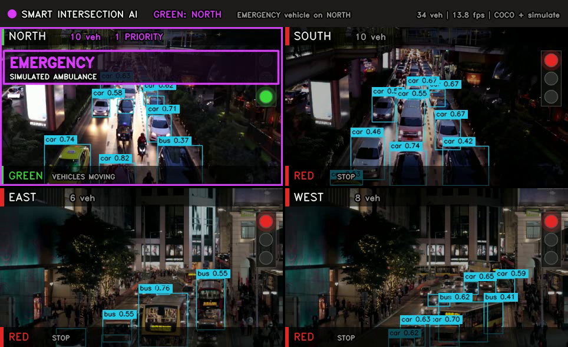
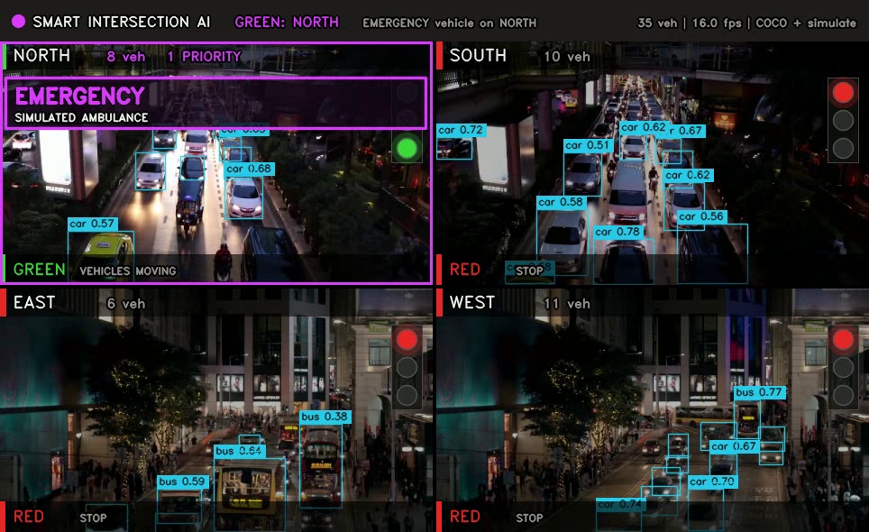

# 🚦 Smart Intersection AI — Priority Traffic Router

> **Traffic lights that can SEE.** Four cameras watch the approach roads; the AI picks the
> green light — **ambulance / police first**, otherwise the busiest lane.

<p align="center">
  
  
  
  
  
</p>



---

## 📌 Status at a glance (read this first)

This project is **running code, not a mock-up**. Everything below is the honest state of it:

| Capability | State | Notes |
|---|---|---|
| 2×2 live dashboard, 4 lanes, HUD, traffic lights | ✅ working | `python main.py` |
| Vehicle counting per lane (YOLOv8n, pretrained COCO) | ✅ working | night footage from the shipped clips |
| Density-based green selection + fairness timers | ✅ working | unit-tested decision logic |
| Emergency preemption logic (green that lane, red the rest, hold to clear) | ✅ working | 13 unit tests |
| **Real** ambulance recognition | ⚠️ needs `models/best.pt` | COCO has **no** ambulance class — see below |
| Emergency demo *today* | ✅ simulation | `--simulate NORTH` / the dashboard buttons |
| Training pipeline for the ambulance/police model | ✅ written, needs GPU time | `prepare_dataset.py` → `train.py` / Colab |
| Browser dashboard | ✅ working | `python web/dashboard.py` |
| ESP32 / real signal hardware | ❌ future scope | not implemented |

**The one honest limitation:** pretrained YOLOv8 (COCO, 80 classes) knows
`car`, `bus`, `truck`, `motorcycle` — it has never seen the word *ambulance*. So the repo
ships a **simulation mode** (`--simulate`, hotkeys `1–4`, dashboard buttons) that feeds the
real decision logic with a real priority-vehicle event. The moment you drop a trained
`models/best.pt` in place, `detector.py` switches to it automatically and the simulation is no
longer needed. That is the whole point of `prepare_dataset.py` + `train.py`.

---

## 🎬 Demo



| File | What it shows |
|---|---|
| `demo/demo.mp4` | 20 s rendered run (H.264, 964×590): live detection, density switching, two simulated ambulance overrides |
| `demo/dashboard.png` | normal operation — busiest lane green, others red |
| `demo/emergency.png` | emergency override — flashing magenta banner, ambulance lane green |
| `demo/decision_log.csv` | one row per lane per frame: counts, light, green lane, reason |

---

## 🧠 How it decides

```
        ┌─────────────┐   ┌───────────────┐   ┌──────────────────┐   ┌──────────────┐
4 cameras →  YOLOv8    →   per-lane count  →   priority?         →   lights + HUD
        └─────────────┘   + priority list     ┌── yes → that lane GREEN, rest RED
                                              └── no  → busiest lane GREEN
```

Full rule order (implemented in `controller.py`, tested in `tests/`):

1. **Emergency** — any lane with an ambulance/police/fire vehicle gets GREEN immediately, even
   inside another lane's green time. Two emergencies → the lane with more priority vehicles wins.
2. **Hold** — when the ambulance leaves the frame its lane stays GREEN for
   `--emergency-hold` seconds, because a convoy follows it.
3. **Density** — no emergency → the lane with most vehicles gets GREEN, but only if it leads the
   current lane by `--switch-margin` vehicles (hysteresis: kills 1-car flicker).
4. **Fairness** — every lane holds green at least `--min-green` seconds, and an empty junction
   keeps the last green instead of going dark.

---

## 🚀 Quick start

```bash
git clone https://github.com/Devesh-tiw/Priority_Traffic_router.git
cd Priority_Traffic_router
pip install -r requirements.txt

python main.py                      # live window, demo clips, hotkeys 1-4
```

No display (server / lab PC without GUI)? Render a video instead:

```bash
python main.py --headless --save demo/demo.mp4 --frames 500 \
               --simulate NORTH:3:7 --simulate EAST:12:7
```

Browser dashboard:

```bash
python web/dashboard.py             # open http://localhost:5000
```

### Common commands

```bash
# four separate clips, N S E W
python main.py --source n.mp4,s.mp4,e.mp4,w.mp4

# two webcams reused for four lanes
python main.py --source 0 --source 0 --source 1 --source 1

# trained ambulance model
python main.py --weights models/best.pt

# slow CPU? detect every 3rd frame
python main.py --detect-every 3

# record a decision log (good for the report)
python main.py --log demo/decision_log.csv

# run the tests
python -m unittest discover -s tests -v
```

| Flag | Default | Meaning |
|---|---|---|
| `--source` | demo clips | repeat 4× (or comma separated): video path / camera index |
| `--weights` | auto | `models/best.pt` if present, else `yolov8n.pt` |
| `--simulate LANE[:START[:DUR]]` | – | fake ambulance for demos, repeatable |
| `--min-green` | 3.0 s | minimum green time per lane |
| `--emergency-hold` | 6.0 s | green held after the ambulance leaves |
| `--switch-margin` | 2 | vehicle lead needed to steal the green |
| `--detect-every` | 2 | run YOLO every Nth frame |
| `--save` / `--headless` | – | write the dashboard to .mp4 / no window |
| `--log` | – | per-frame CSV decision log |

**Hotkeys:** `Q` quit · `1 2 3 4` simulate an ambulance on N / S / E / W.

> `--save` writes H.264 when your OpenCV build has the encoder, otherwise `mp4v`. Browsers only
> play H.264, so if the file looks blank in a browser: `ffmpeg -i demo.mp4 -c:v libx264 -pix_fmt yuv420p out.mp4`.

---

## 📁 Project structure

```
Priority_Traffic_router/
├── main.py                 # CLI entry point (start here)
├── smart_intersection.py   # Lane, EmergencySimulator, GridRenderer, SmartIntersectionAI
├── controller.py           # decision logic only — no cv2, fully unit-tested
├── detector.py             # YOLOv8 wrapper, COCO ↔ custom-model adaptation
├── config.py               # every tunable value in one place
├── prepare_dataset.py      # frames → pre-label → split → data.yaml
├── train.py                # fine-tune YOLOv8 on ambulance/police, auto-copies best.pt
├── data.yaml               # 4 classes: ambulance, police, car, motorcycle
├── web/dashboard.py        # Flask + MJPEG browser dashboard
├── notebooks/train_colab.ipynb  # free-GPU training notebook
├── tests/test_controller.py     # 13 tests for the decision logic
├── docs/
│   ├── REPORT.docx         # submission report (regenerate: python docs/build_report.py)
│   ├── VIVA_QA.md          # 22 likely questions with model answers
│   ├── CHECKLIST.md        # what was found, fixed, and what remains (read first)
│   ├── arch.png            # system architecture diagram
│   └── decision_flow.png   # decision-rule flow diagram
├── demo/                   # demo.mp4, screenshots, decision log
├── models/                 # put best.pt here
├── yolov8n.pt              # pretrained base weights (COCO, 6.5 MB)
├── Traffic_north_south.mp4 # sample night footage (1280×720, 21 s)
└── Traffic_east_west.mp4   # sample night footage (2560×1440, 20 s)
```

---

## 🏋️ Training the real ambulance model (the remaining piece)

`data.yaml` defines **0 ambulance · 1 police · 2 car · 3 motorcycle**. Class *ids* don't matter
to the code — `detector.py` classifies by **name keywords**, so any model whose class names
contain `ambulance`, `police`, `fire`, ... is picked up correctly.

```bash
python prepare_dataset.py frames --video Traffic_east_west.mp4 --out dataset/raw/images
python prepare_dataset.py prelabel                    # auto-labels cars (big time-saver)
# → draw ambulance + police boxes by hand in labelImg / Roboflow
python prepare_dataset.py split                       # train/val + data.yaml + class balance
python train.py --epochs 100                          # or use notebooks/train_colab.ipynb
```

`train.py` copies the best weights to `models/best.pt`, and `main.py` starts using them with no
flags. On a free Colab T4, ~1–3k images takes 40–90 minutes.

> **Check per-class mAP, not overall mAP.** Cars dominate any traffic dataset, so overall mAP can
> look great while `ambulance` is bad. If ambulance AP50 < 0.6, add more ambulance images —
> especially Indian 108/EMRI ambulances, at night, from the rear and side.

---

## ✅ How this was verified

| Check | Command | Result |
|---|---|---|
| Unit tests (no GPU needed) | `python -m unittest discover -s tests -v` | 13/13 pass |
| Runs on a clean copy of the code | fresh folder + `main.py` | passes |
| Custom-model mode switches automatically | fake 4-class checkpoint loaded | `mode: CUSTOM`, priority → `ambulance, police` |
| Browser dashboard + API | `curl /api/state`, `POST /api/trigger/NORTH` | emergency override confirmed |
| Demo render reproduces | `--headless --save ... --simulate ...` | 500 frames, 20 s |

## 📊 Results (measured, not guessed)

Measured on a **2-vCPU CPU-only** machine (no GPU), 4 lanes, `imgsz=640`, `--detect-every 2`:

| Metric | Value |
|---|---|
| Detection throughput | ≈ 4.5–5 dashboard frames/s (0.2 s per 4-lane step) |
| Single YOLOv8n pass (640px, CPU) | ~72 ms |
| Vehicles detected per night frame | 5–13 per lane with the pretrained COCO model |
| Decision latency | < 1 frame after detection (pure Python, microseconds) |
| Test suite | 13/13 passing |

The *decision* is fast; the *detector* is the bottleneck, which is why `--detect-every`,
`imgsz` and a GPU exist. A real deployment would use a Jetson or a GPU and hit video rate.

---

## ⚠️ Limitations (say these before an examiner says them)

1. **No ambulance class in pretrained COCO** → simulation mode until you train `best.pt`.
2. **The demo clips contain no emergency vehicles** — they are night-time city traffic, used here
   to prove detection, counting and switching.
3. **Two clips feed four lanes** (offset so they don't look identical). Real footage would be 4
   independent streams.
4. **No hardware.** The "signal" is drawn on screen; nothing switches a real LED yet.
5. **Night/glare/low-light** reduces detection confidence — the reason `train.py` uses strong
   `hsv_v` / `hsv_s` augmentation.

---

## 🔮 Roadmap

| Phase | Work | Status |
|---|---|---|
| 1 | Label + train ambulance/police model (Colab) | ⏳ needs labeling time |
| 2 | Evaluate per-class mAP, tune conf threshold | ⏳ |
| 3 | ESP32 / Raspberry Pi driving real LEDs over serial or MQTT | ❌ |
| 4 | Siren (audio) fusion to catch ambulances the camera misses | ❌ |
| 5 | Multi-junction coordination (green wave for an ambulance route) | ❌ |

---

## 👥 Team

**B.Tech AI Engineering, Amrita Vishwa Vidyapeetham (Amaravati)**

| Member | Roll No | GitHub |
|---|---|---|
| Devesh Tiwari | AV.SC.U4AIE25106 | [@Devesh-tiw](https://github.com/Devesh-tiw) |
| D. Mani Teja | AV.SC.U4AIE25103 | — |
| C. Pranweswar | AV.SC.U4AIE25102 | — |

## 📄 License

MIT — see [LICENSE](LICENSE).

<p align="center"><i>Ambulance gets GREEN first. Always. 🚑💨</i></p>
